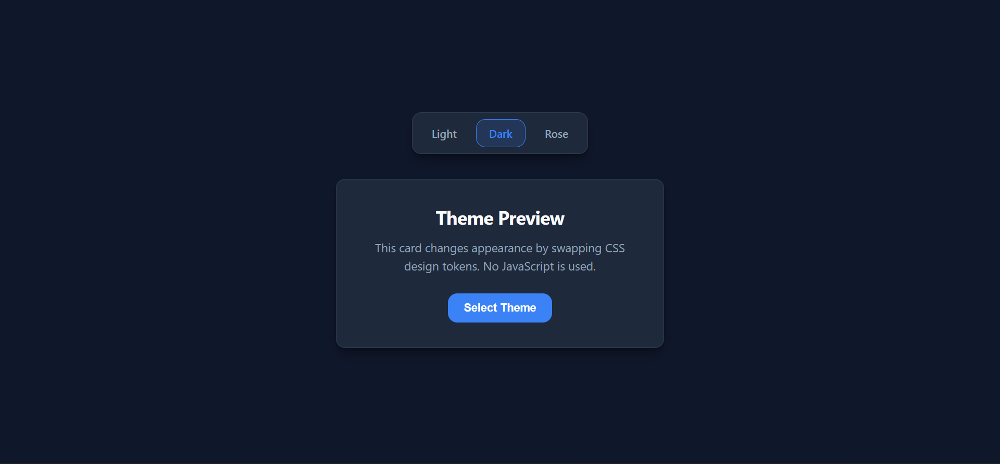

# Theme Switcher 🎨



## About

A simple theme switcher that lets users toggle between Light, Dark, and Rose themes without using any JavaScript. The project follows the [Theme Switcher roadmap](https://roadmap.sh/projects/theme-switcher) project definition from roadmap.sh.

### Project Definition

The goal of this project is to build a theme switcher component that allows users to change the appearance of a page by selecting from predefined color themes. It demonstrates theming with CSS custom properties (variables) and semantic styling.

### How It Was Implemented

The implementation uses only HTML and CSS:

- Three radio inputs (`light`, `dark`, `rose`) act as the theme selector.
- CSS custom properties (`--color-bg`, `--color-surface`, `--color-text`, etc.) are defined as design tokens under `:root` for the default light theme.
- The `:has()` pseudo-class is used to override the design tokens when the `dark` or `rose` radio option is checked, switching the entire page appearance without JavaScript.
- All colors, borders, shadows, and transitions reference the CSS variables, so changing a theme instantly updates every element.

## How to Run Locally

1. Clone this repository:

    ```bash
    git clone https://github.com/DevMasen/theme-switcher-with-css-variables.git
    ```

2. Navigate into the project folder:

    ```bash
    cd theme-switcher-with-css-variables
    ```

3. Open `index.html` in your browser:

    ```bash
    start index.html
    ```

    Or simply double-click `index.html` to open it.

No build step or dependencies are required.

## Project Definition

[Theme Switcher on roadmap.sh](https://roadmap.sh/projects/theme-switcher)

## Vote

Vote for this project with this [LINK](https://roadmap.sh/projects/theme-switcher/solutions?u=66107474da1671f986289b45) if you like.

## Thank You

Thank you for visiting my GitHub! 🙏
